# 🏙️ Municipal Services Application - ST10535591

## Tshwarelo Lephoto

A Windows Forms desktop application designed to provide community members with access to municipal services, local events, announcements, and service request information.

The application was developed as part of the Municipal Services Application project. It combines the issue-reporting functionality from Part 1, the Local Events and Announcements functionality from Part 2, and the advanced data structures and algorithms implemented in Part 3.

Part 3 focuses on the **Service Request Status** functionality and the practical implementation of advanced data structures, including Binary Trees, Binary Search Trees, AVL Trees, Red-Black Trees, Min-Heaps, Graphs, Graph Traversal, and Minimum Spanning Trees.

The application uses SQL Server LocalDB for persistent data storage and Entity Framework 6 for database operations.

---

# 🚀 Getting Started

## Requirements

Before running the application, make sure you have:

- 🪟 Windows 10 or Windows 11
- 💻 Visual Studio 2022 or later
- 🧩 .NET Desktop Development workload
- 🛠️ .NET Framework 4.8 Developer Pack
- 🗄️ SQL Server LocalDB
- 📦 NuGet package support

The application uses **SQL Server LocalDB** for data storage and **Entity Framework 6** for database communication.

---

# 📥 Download / Clone the Project

Clone the GitHub repository:

```bash
git clone https://github.com/CodeByRelo/MunicipalityServiceApp2.git
```

Or download the repository as a ZIP file from GitHub and extract it.

---

# ▶️ Compile and Run

1. Open `MunicipalityServiceApp2.sln` in Visual Studio.
2. Allow Visual Studio to restore the required NuGet packages.
3. Confirm that SQL Server LocalDB is installed and available.
4. Check the database connection string in `App.config`.
5. Select **Build → Build Solution**.
6. Confirm that the solution builds successfully.
7. Press **F5** or select **Debug → Start Debugging**.
8. The Municipal Services Application will open on the main dashboard.

The application uses Entity Framework 6 to communicate with SQL Server LocalDB.

## Database Setup

The application uses the following database:

```text
MunicipalityServiceApp2Db
```

The connection string is configured in `App.config`:

```xml
<connectionStrings>
  <add name="MunicipalityConnection"
       connectionString="Data Source=(localdb)\MSSQLLocalDB;Initial Catalog=MunicipalityServiceApp2Db;Integrated Security=True;MultipleActiveResultSets=True"
       providerName="System.Data.SqlClient" />
</connectionStrings>
```

If the database has not been created yet:

1. Open Visual Studio.
2. Select **Tools → NuGet Package Manager → Package Manager Console**.
3. Select the application project as the default project.
4. Run:

```powershell
Update-Database
```

This applies the existing Entity Framework migrations and creates or updates the database.

If the database already exists and is up to date, this step is not necessary.

---

# 🧭 Using the Application

## 🏠 Main Dashboard

The dashboard is the main entry point of the application.

It provides:

- Welcome section
- Municipal service statistics
- Report Issue action
- Recent service requests
- Quick access options
- Sidebar navigation

The main navigation provides access to:

- 🚨 Report Issue
- 📋 My Requests
- 📅 Events
- ⚙️ Manage Requests

The application uses a panel-based navigation system to display different sections within the main Windows Form.

### 📸 Screenshot

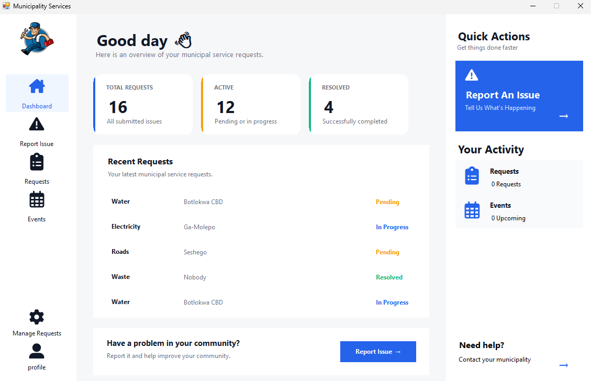

---

## 🚨 Reporting an Issue

The issue-reporting functionality from Part 1 has been carried forward into the final application.

To submit a municipal issue:

1. Select **Report Issue**.
2. Enter the issue location.
3. Select an issue category.
4. Enter a description.
5. Optionally select supporting evidence.
6. Select **Submit Issue**.

### Available Categories

- 🧹 Sanitation
- 🛣️ Roads
- 💧 Water
- ⚡ Electricity
- 🗑️ Waste Management
- 📌 Other

Submitted issues are stored in SQL Server LocalDB and automatically receive a unique identifier.

Each new request is initially assigned a **Pending** status.

### 📸 Screenshot

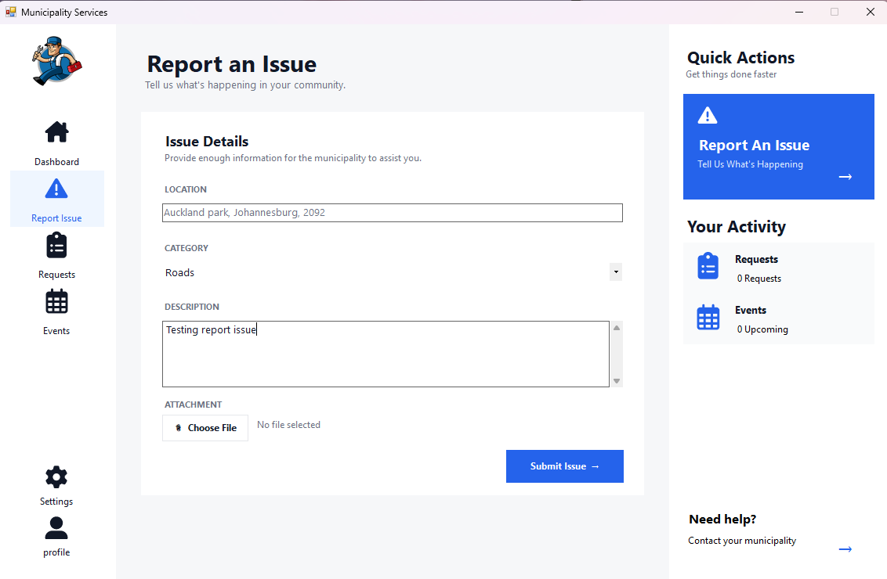

---

## 📋 Service Request Status

The Service Request Status functionality allows users to view previously submitted municipal issues and track their progress.

The My Requests page displays an organised list of submitted requests.

Each request provides information such as:

- Request ID
- Location
- Category
- Description
- Current status
- Date reported

Users can select an individual request to view additional details.

The request status follows these stages:

```text
Pending → In Progress → Resolved
```

The unique request ID allows individual requests to be identified and retrieved through the implemented tree structures.

### 📸 Screenshot

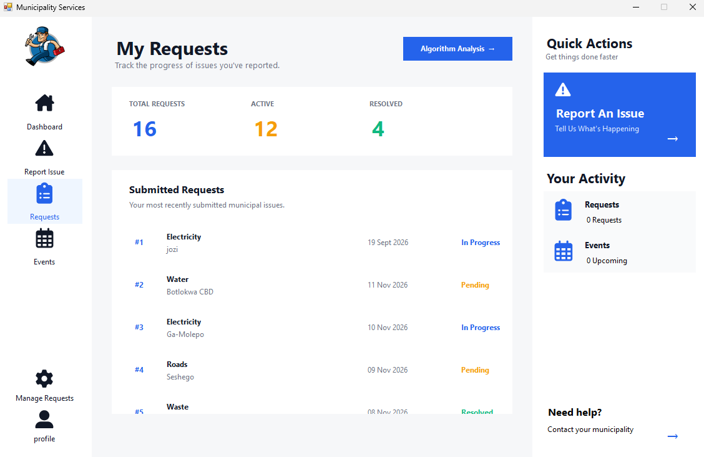

## 🔍 Request Details and Progress

When a request is selected, the application displays its details and current progress.

The request details page provides information about the selected issue and its current status.

This allows users to identify a particular request and understand its progress.

### 📸 Screenshot

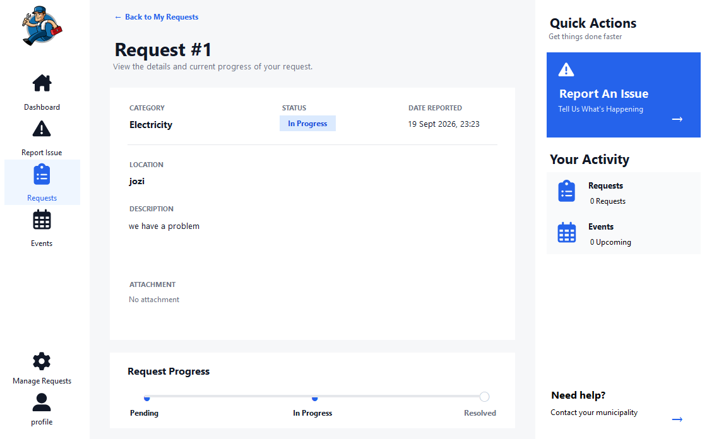

---

## ⚙️ Manage Requests

The application includes a request management section that allows requests to be reviewed and their statuses updated.

To manage a request:

1. Open the Manage Requests section.
2. Select a service request.
3. Review the request information.
4. Select the required status.
5. Save the update.

The available statuses are:

- Pending
- In Progress
- Resolved

Changes are saved to the SQL Server database.

After a successful update, the application's issue data structures are refreshed so that the latest request information is used by the algorithms.

The Manage Requests list also uses the Min-Heap to organise requests according to the implemented priority rules.

### 📸 Screenshot

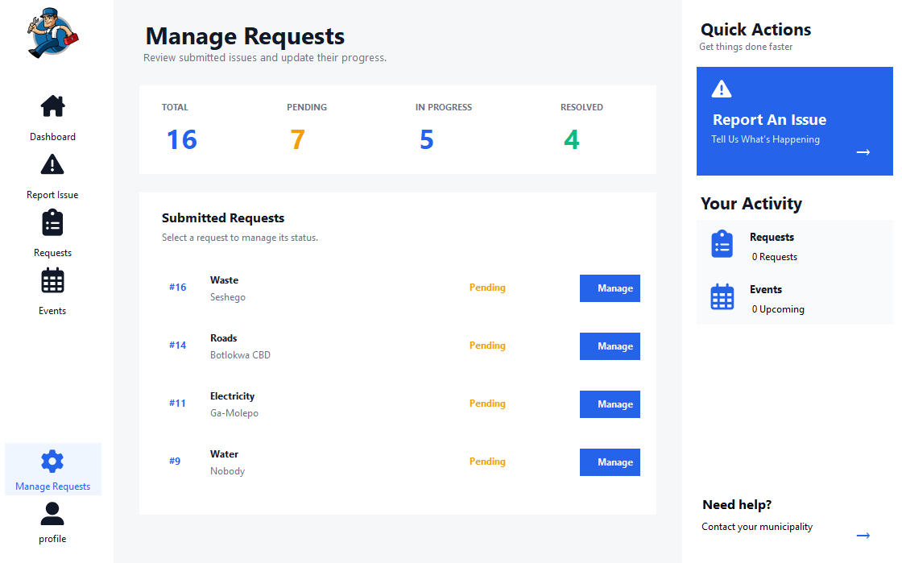

### 📸 Screenshot

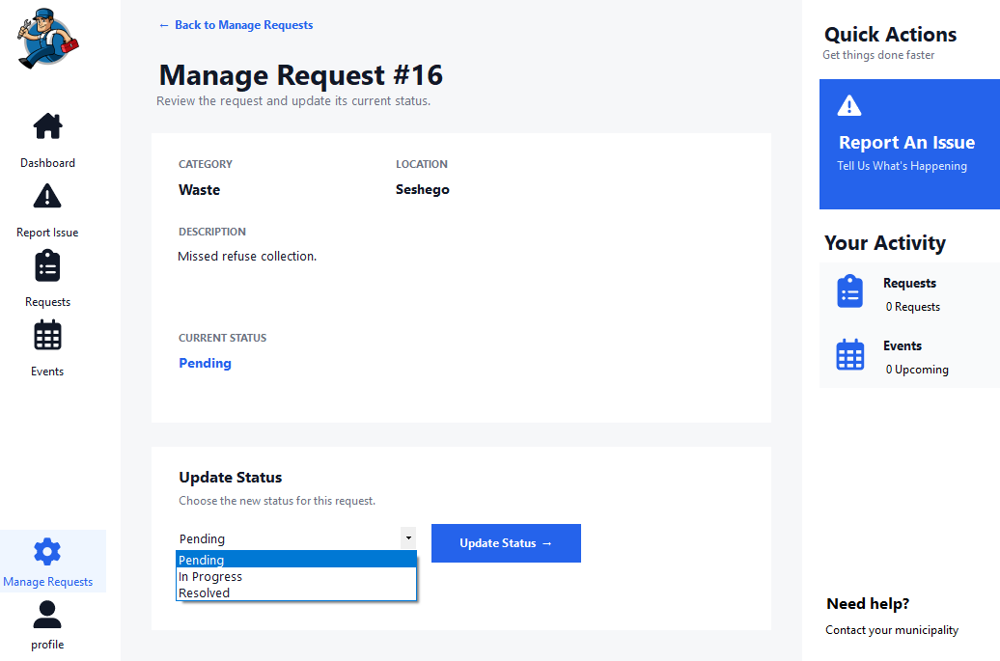

---

# 📅 Local Events and Announcements

The Local Events and Announcements page provides users with upcoming community events and active municipal announcements.

Events are retrieved from SQL Server LocalDB and displayed using a card-based interface.

Each event can display:

- Event name
- Category
- Priority
- Date
- Time
- Location

Users can select an event to view additional information.

### 📸 Screenshot

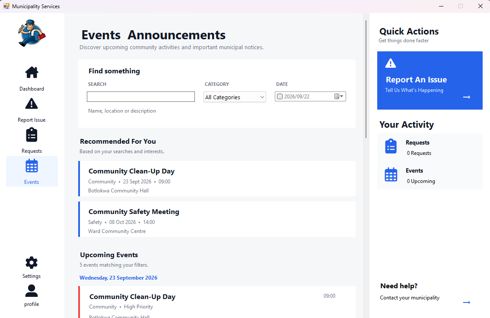

---

# 🔎 Event Search and Filtering

The Events page provides several ways to find relevant events.

Users can search using:

- Event name
- Location
- Description

Events can also be filtered by:

- Category
- Date

The search results update dynamically based on the selected filters.

### 📸 Screenshots

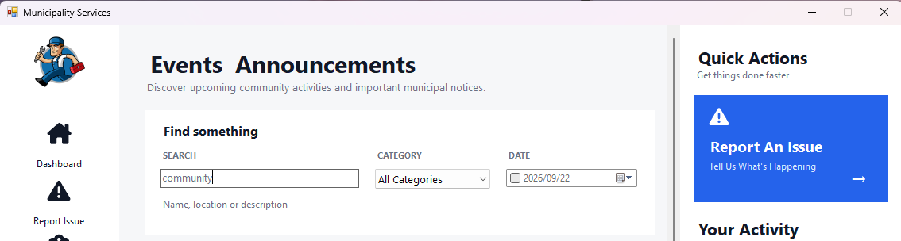

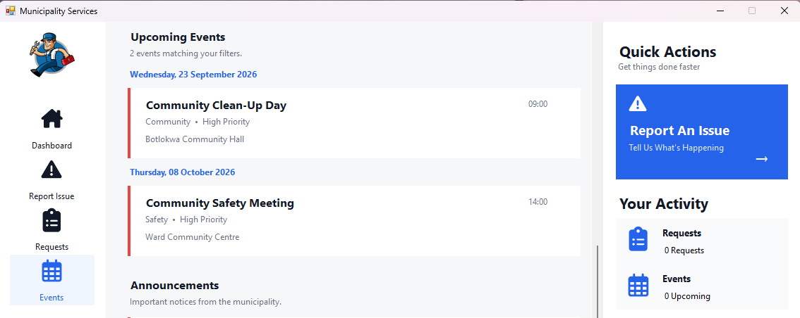

---

# ⭐ Event Recommendations

The application includes a recommendation feature based on user searches and preferences.

The recommendation system considers:

- Search keywords
- Selected event categories
- Repeated searches
- Event titles
- Event descriptions
- Event locations
- Event priority

Events receive recommendation scores based on their relationship to the user's search behaviour.

The highest-scoring events are displayed in the **Recommended For You** section.

### 📸 Screenshot

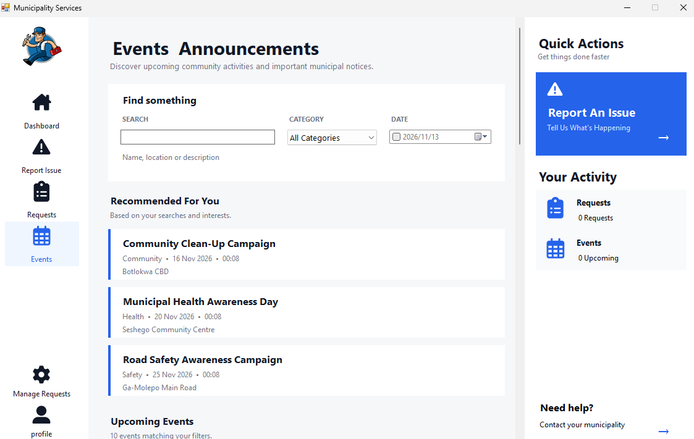

---

# 📰 Announcements

Active municipal announcements are displayed to provide residents with important community information.

Announcements can include:

- Announcement title
- Category
- Priority
- Message

Only active announcements are displayed to users.

### 📸 Screenshot

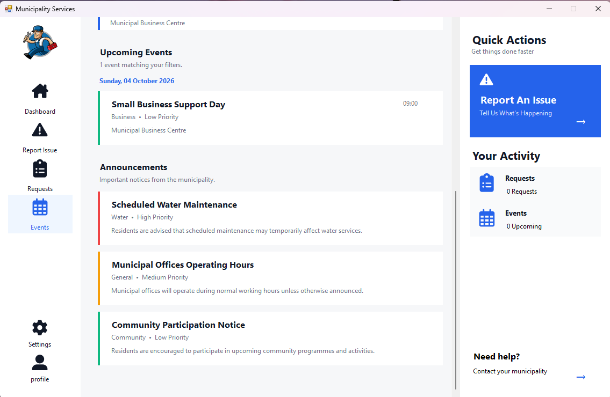

---

# 🧠 Advanced Data Structures and Algorithms – Part 3

Part 3 introduces advanced data structures and algorithms to improve how service request information is organised, retrieved and processed.

The structures are implemented in C# and integrated through the `IssueAlgorithmService` class.

The application uses different structures for different operations instead of relying on a single collection for every task.

---

## 🌳 Basic Tree Concepts

A tree is a non-linear data structure consisting of nodes connected through parent-child relationships.

Important tree terminology includes:

- **Root:** The first node in the tree.
- **Parent:** A node that has one or more children.
- **Child:** A node connected below another node.
- **Leaf:** A node without children.
- **Subtree:** A smaller tree contained within a larger tree.

Trees are useful for organising information hierarchically and providing different ways to retrieve data.

In this application, each tree node stores an `Issue` object containing the information associated with a municipal service request.

---

## 🌳 Binary Tree

**Implementation:** `BinaryTree.cs`

A Binary Tree is a tree structure in which each node can have a maximum of two children:

- Left child
- Right child

The implemented Binary Tree stores an `Issue` object in each node and maintains references to its left and right children.

The implementation supports:

- Setting the root node.
- Inserting left children.
- Inserting right children.
- Pre-order traversal.
- In-order traversal.
- Post-order traversal.

### Role in the Application

The Binary Tree is used to organise the service requests in a hierarchical structure.

The `IssueAlgorithmService` retrieves the current issues from the database and builds the tree using level-order insertion.

The first issue becomes the root. Subsequent issues are inserted into available left and right positions, filling the tree level by level.

The structure demonstrates how service requests can be organised and accessed through different traversal methods.

### Tree Traversals

**Pre-order Traversal**

Visits the root first, followed by the left subtree and then the right subtree.

```text
Root → Left → Right
```

**In-order Traversal**

Visits the left subtree, the root and then the right subtree.

```text
Left → Root → Right
```

**Post-order Traversal**

Visits the left subtree, the right subtree and then the root.

```text
Left → Right → Root
```

### Example

Consider the following Binary Tree:

```text
          101
         /   \
       102   103
      /  \
    104  105
```

The traversal results are:

| Traversal  | Result                  |
| ---------- | ----------------------- |
| Pre-order  | 101, 102, 104, 105, 103 |
| In-order   | 104, 102, 105, 101, 103 |
| Post-order | 104, 105, 102, 103, 101 |

Each traversal visits every node once, giving a time complexity of **O(n)**.

This structure demonstrates hierarchical organisation and different methods of processing service requests.

### 📸 Screenshot

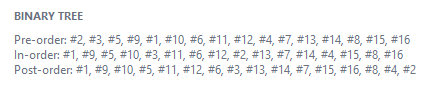

---

## 🌲 Binary Search Tree (BST)

**Implementation:** `BinarySearchTree.cs`

A Binary Search Tree is a Binary Tree that follows an ordering rule:

- Values smaller than the current node are placed in the left subtree.
- Values greater than the current node are placed in the right subtree.

The application uses the unique issue ID to organise the requests.

The implementation supports:

- Inserting service requests.
- Searching for a request by ID.
- In-order traversal.
- Retrieving requests in ascending ID order.

Duplicate identifiers are ignored.

### Role in the Application

The BST provides an organised way of retrieving requests using their unique identifiers.

For example, when searching for request `60`, the algorithm compares the requested ID with the current node.

If the requested ID is smaller, the search moves left. If it is greater, the search moves right.

This continues until the request is found or the search reaches an empty position.

The in-order traversal also provides a sorted list of requests by their identifiers.

### Example

```text
             50
            /  \
          30    70
         / \    / \
        20 40  60 80
```

Searching for request `60`:

1. Compare 60 with 50.
2. Move right because 60 is greater than 50.
3. Compare 60 with 70.
4. Move left because 60 is smaller than 70.
5. Request 60 is found.

### Efficiency

| Operation          | Average Case | Worst Case |
| ------------------ | ------------ | ---------- |
| Search             | O(log n)     | O(n)       |
| Insertion          | O(log n)     | O(n)       |
| In-order traversal | O(n)         | O(n)       |

The BST provides efficient searching when reasonably balanced. However, it can become unbalanced when values are inserted in an unfavourable order.

### 📸 Screenshot

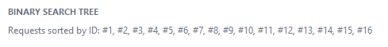

---

## ⚖️ AVL Tree

**Implementation:** `AVLTree.cs`

An AVL Tree is a self-balancing Binary Search Tree.

It maintains the normal BST ordering rules while ensuring that the height difference between the left and right subtrees of a node does not exceed one.

This difference is called the **Balance Factor**.

```text
Balance Factor =
Height of Left Subtree - Height of Right Subtree
```

A node is considered balanced when its balance factor is -1, 0 or 1.

When an insertion causes an imbalance, rotations are performed to restore the tree's balance.

The implementation supports four rotation cases:

- LL Rotation
- RR Rotation
- LR Rotation
- RL Rotation

### Role in the Application

The AVL Tree stores service requests according to their unique identifiers.

The `IssueAlgorithmService` uses the AVL Tree when retrieving an individual request through:

```csharp
FindIssueById(int id)
```

For example, when a user selects request `105` to view its details, the application refreshes the issue structures and retrieves the request using the AVL Tree.

Because the AVL Tree maintains its balance, searching remains efficient even when requests are inserted in an unfavourable order.

### Efficiency

| Operation          | Time Complexity   |
| ------------------ | ----------------- |
| Search             | O(log n)          |
| Insertion          | O(log n)          |
| Rotation           | O(1) per rotation |
| In-order traversal | O(n)              |

The AVL Tree provides predictable search performance by preventing the tree from becoming excessively unbalanced.

### 📸 Screenshot


---

## 🔴 Red-Black Tree

**Implementation:** `RedBlackTree.cs`

A Red-Black Tree is another self-balancing Binary Search Tree.

Each node is assigned a colour:

- Red
- Black

The tree follows a set of balancing properties:

1. Every node is either red or black.
2. The root node is black.
3. Null leaf references are treated as black.
4. A red node cannot have a red parent or red child.
5. Every path from a node to its descendant null leaves contains the same number of black nodes.

When a new node is inserted, the tree checks whether any of these properties have been violated.

If necessary, recolouring and rotations are performed to restore the required properties.

The implementation supports:

- Inserting service requests.
- Searching for requests using their IDs.
- In-order traversal.
- Rebalancing after insertion.

### Role in the Application

The Red-Black Tree provides another efficient method of retrieving service requests using their unique identifiers.

The `IssueAlgorithmService` exposes:

```csharp
FindIssueUsingRedBlackTree(int id)
```

This method is used when retrieving a request for the request management details page.

For example, when an administrator opens a request to update its status, the application can retrieve the corresponding issue using the Red-Black Tree.

### Efficiency

| Operation          | Time Complexity   |
| ------------------ | ----------------- |
| Search             | O(log n)          |
| Insertion          | O(log n)          |
| Rotation           | O(1) per rotation |
| In-order traversal | O(n)              |

### AVL Tree vs Red-Black Tree

Both structures maintain the BST ordering rules and prevent the tree from becoming excessively unbalanced.

The AVL Tree maintains stricter balance, while the Red-Black Tree uses colour properties to allow more flexibility in its balancing.

Both provide logarithmic search and insertion performance.

### 📸 Screenshot


---

## ⬇️ Min-Heap

**Implementation:** `MinHeap.cs`

A Heap is a specialised tree-based data structure that follows a heap-ordering property.

The application implements a **Min-Heap**, where the smallest element according to the application's comparison rules is stored at the root.

The Min-Heap is implemented using a `List<Issue>`.

The implementation supports:

- Inserting requests.
- Retrieving the highest-priority request using `Peek()`.
- Removing the highest-priority request using `ExtractMin()`.
- Returning requests in priority order.
- Maintaining heap order using `HeapifyUp()` and `HeapifyDown()`.

### Request Priority Rules

The heap does not use a separate numeric priority property.

Instead, requests are compared using their status, reporting date and unique identifier.

The ordering is:

| Priority | Status                    |
| -------- | ------------------------- |
| 1        | Pending                   |
| 2        | In Progress               |
| 3        | Resolved                  |
| 4        | Other or unknown statuses |

When two requests have the same status, the request reported earlier is placed first.

If the status and reporting date are also equal, the issue ID is used as the final comparison.

### Role in the Application

The Min-Heap organises requests according to their current status and reporting date.

The `IssueAlgorithmService` exposes:

```csharp
GetIssuesByPriority()
GetNextPriorityIssue()
```

The Manage Requests section uses the priority-ordered list to display requests according to the implemented rules.

For example:

| Request ID | Status      | Date Reported |
| ---------- | ----------- | ------------- |
| 101        | Resolved    | 10 November   |
| 102        | Pending     | 12 November   |
| 103        | In Progress | 11 November   |
| 104        | Pending     | 10 November   |

The resulting order is:

```text
104 → Pending
102 → Pending
103 → In Progress
101 → Resolved
```

Request 104 appears before request 102 because both are Pending, but request 104 was reported earlier.

### Efficiency

| Operation                      | Time Complexity |
| ------------------------------ | --------------- |
| Insert                         | O(log n)        |
| Peek                           | O(1)            |
| Extract minimum                | O(log n)        |
| Retrieve all in priority order | O(n log n)      |

The heap makes the next request according to the defined priority rules immediately accessible.

### 📸 Screenshot

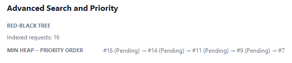

---

# 🌐 Graphs and Network Relationships

## Graph

**Implementation:** `Graph.cs`  
**Supporting Model:** `GraphEdge.cs`

A Graph is a non-linear data structure consisting of vertices and edges.

- **Vertex:** Represents a location or point.
- **Edge:** Represents a connection between two vertices.
- **Weight:** Represents a value assigned to a connection, such as an illustrative distance or cost.

The application implements a **weighted, undirected graph** using an adjacency list.

The adjacency list stores each vertex together with the collection of vertices connected to it.

The implementation uses a dictionary to maintain these relationships.

The Graph supports:

- Adding vertices.
- Adding connections between vertices.
- Checking whether a vertex exists.
- Checking whether two vertices are connected.
- Retrieving neighbouring vertices.
- Retrieving all graph edges.
- Preventing duplicate connections.
- Rejecting invalid connections and negative weights.

### Role in the Application

The Graph demonstrates how relationships between different municipal locations can be represented and analysed.

For example, different municipal service areas can be represented as vertices, while connections between those areas can represent possible routes or infrastructure links.

The user can enter:

- Source location.
- Destination location.
- Connection weight.

The application then stores the connection in the graph.

Because the graph is undirected, a connection between Location A and Location B can be followed in either direction.

### Example

```text
Botlokwa CBD ----- Ga-Molepo
       |                 |
       |                 |
     Nobody --------- Seshego
```

Example connections:

| Source       | Destination | Weight |
| ------------ | ----------- | -----: |
| Botlokwa CBD | Ga-Molepo   |     10 |
| Botlokwa CBD | Nobody      |      5 |
| Ga-Molepo    | Nobody      |      3 |
| Nobody       | Seshego     |      6 |

These are demonstration values entered by the user. They do not represent automatically calculated geographical distances.

### Efficiency

| Operation           | Typical Time Complexity                                            |
| ------------------- | ------------------------------------------------------------------ |
| Add vertex          | O(1) average                                                       |
| Add edge            | O(degree of source + degree of destination) in this implementation |
| Retrieve neighbours | O(1) average to retrieve the list                                  |
| Graph traversal     | O(V + E)                                                           |

V represents the number of vertices, while E represents the number of edges.

The adjacency-list approach stores existing connections rather than maintaining a full matrix of every possible connection.

### 📸 Screenshot

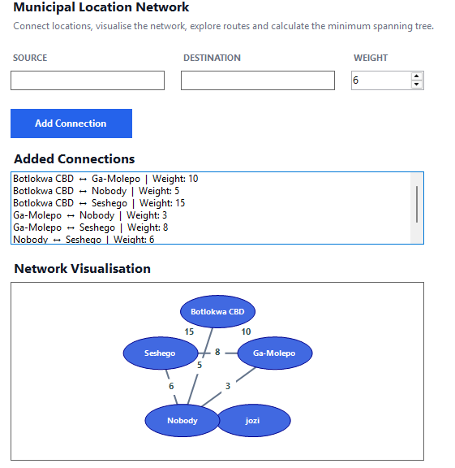

---

## 🔎 Breadth-First Search (BFS)

**Implementation:** `GraphTraversal.cs`

Breadth-First Search is a graph traversal algorithm that explores neighbouring vertices before moving further away from the starting vertex.

The implementation uses:

- `Queue<string>` to manage the order in which vertices are visited.
- `HashSet<string>` to keep track of visited vertices.

### How It Works

1. Select a starting location.
2. Add the starting location to the queue.
3. Mark the location as visited.
4. Remove the first location from the queue.
5. Visit its unvisited neighbours.
6. Add those neighbours to the queue.
7. Continue until the queue is empty.

### Example

Using the municipal connections:

```text
Botlokwa CBD → Ga-Molepo
Botlokwa CBD → Nobody
Ga-Molepo → Seshego
Nobody → Seshego
```

Starting at Botlokwa CBD, BFS explores the immediate neighbours first.

A possible traversal order is:

```text
Botlokwa CBD
Ga-Molepo
Nobody
Seshego
```

The exact order depends on the order in which neighbours are returned by the graph implementation.

### Role in the Application

BFS allows the application to explore connected municipal locations systematically.

For example, it demonstrates how a network can be explored from a starting service area to identify all reachable connected areas.

### Efficiency

BFS has a time complexity of:

**O(V + E)**

Each reachable vertex is visited at most once, and its connections are examined during traversal.

### 📸 Screenshot

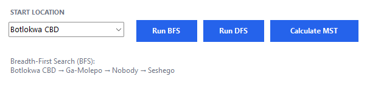

---

## 🔍 Depth-First Search (DFS)

**Implementation:** `GraphTraversal.cs`

Depth-First Search is a graph traversal algorithm that explores one path as far as possible before returning to explore another path.

The implementation uses:

- `Stack<string>` to manage the traversal order.
- `HashSet<string>` to keep track of visited vertices.

### How It Works

1. Select a starting location.
2. Push the starting location onto the stack.
3. Remove the top location from the stack.
4. If it has not been visited, mark it as visited.
5. Add its unvisited neighbours to the stack.
6. Continue until the stack is empty.

### Example

Using the same municipal network, DFS explores one connected path before returning to explore another path.

A possible traversal order is:

```text
Botlokwa CBD
Nobody
Seshego
Ga-Molepo
```

The exact order depends on the order in which neighbouring vertices are pushed onto the stack.

### Role in the Application

DFS provides another method of exploring the municipal connection network.

It demonstrates how a network can be explored by following one path deeply before backtracking to other available connections.

### Efficiency

DFS has a time complexity of:

**O(V + E)**

Each reachable vertex is visited at most once, and its connections are examined during traversal.

### BFS vs DFS

| BFS                               | DFS                                |
| --------------------------------- | ---------------------------------- |
| Uses a Queue                      | Uses a Stack                       |
| Explores level by level           | Explores one path deeply           |
| Visits immediate neighbours first | Follows a path before backtracking |
| O(V + E)                          | O(V + E)                           |

### 📸 Screenshot

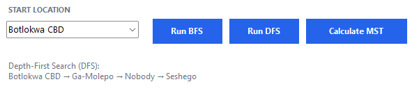

---

## 🌳 Minimum Spanning Tree (MST) – Kruskal's Algorithm

**Implementation:** `MinimumSpanningTree.cs`

A Minimum Spanning Tree is a subset of edges in a connected, weighted, undirected graph that connects all vertices without creating cycles and has the lowest possible total edge weight.

The application implements **Kruskal's Algorithm** to calculate the minimum spanning tree.

Kruskal's algorithm selects edges in ascending order of weight.

The implementation also uses a Disjoint Set Union structure to determine whether adding an edge would create a cycle.

The Disjoint Set Union implementation uses:

- Parent tracking.
- Rank tracking.
- Path compression.
- Union by rank.

### How It Works

1. Retrieve all graph edges.
2. Sort the edges from lowest weight to highest.
3. Initially treat each vertex as a separate set.
4. Select the next edge with the lowest weight.
5. Check whether the two vertices belong to different sets.
6. If they belong to different sets, include the edge.
7. Merge the two sets.
8. Continue until the required connections have been selected or all edges have been checked.

### Example

Consider the following municipal connections:

| Connection               | Weight |
| ------------------------ | -----: |
| Ga-Molepo – Nobody       |      3 |
| Botlokwa CBD – Nobody    |      5 |
| Nobody – Seshego         |      6 |
| Ga-Molepo – Seshego      |      8 |
| Botlokwa CBD – Ga-Molepo |     10 |
| Botlokwa CBD – Seshego   |     15 |

Kruskal's algorithm selects the lowest-weight connections that do not create cycles.

The selected connections are:

| Selected Connection   | Weight |
| --------------------- | -----: |
| Ga-Molepo – Nobody    |      3 |
| Botlokwa CBD – Nobody |      5 |
| Nobody – Seshego      |      6 |
| **Total Weight**      | **14** |

The result connects all four locations using three connections, with a total weight of 14.

### Role in the Application

The MST functionality demonstrates how the municipality could identify a lower-cost network of connections between different service areas.

For example, it could support an illustrative network-planning exercise where several areas need to be connected while minimising the total assigned connection cost.

The application displays the selected connections and calculates their combined weight.

If the graph is disconnected, the implementation returns a **minimum spanning forest**. This means it calculates minimum-cost connections within each connected component instead of claiming that disconnected locations have been connected.

### Efficiency

Kruskal's algorithm has a typical time complexity of:

**O(E log E)**

The main cost comes from sorting the graph edges. The Disjoint Set Union operations are efficient because the implementation uses path compression and union by rank.

### 📸 Screenshot

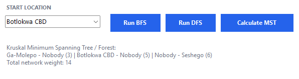

---

# 🔗 Integration of Data Structures

The advanced data structures are integrated through the `IssueAlgorithmService` class.

This service acts as the central point for creating, refreshing and accessing the structures used by the application.

The service maintains:

- BinaryTree
- BinarySearchTree
- AVLTree
- RedBlackTree
- MinHeap
- MunicipalGraph

When the service is initialised, it retrieves the current service requests from the database and populates the tree structures and heap.

The general integration process is:

```text
SQL Server LocalDB
        |
        v
   IssueService
        |
        v
IssueAlgorithmService
        |
        +------------------+
        |                  |
        v                  v
  Tree Structures       Min-Heap
        |
        v
  Service Request UI
```

The graph is maintained separately because its vertices and weighted edges represent relationships between municipal locations rather than individual service requests.

## Where Each Structure Is Used

| Structure / Algorithm | Application Usage                                                            |
| --------------------- | ---------------------------------------------------------------------------- |
| Binary Tree           | Organises requests hierarchically and demonstrates tree traversal.           |
| Binary Search Tree    | Retrieves requests using their unique IDs and returns sorted IDs.            |
| AVL Tree              | Retrieves individual requests while maintaining balanced search performance. |
| Red-Black Tree        | Retrieves requests through the request management functionality.             |
| Min-Heap              | Organises requests according to status, reporting date and ID.               |
| Graph                 | Stores connections between municipal locations.                              |
| BFS                   | Explores connected locations level by level.                                 |
| DFS                   | Explores connected locations depth first.                                    |
| Kruskal's MST         | Selects minimum-weight connections without cycles.                           |

## Refreshing the Structures

The application refreshes its issue structures after relevant database operations.

For example:

- When a new issue is submitted, the structures are rebuilt to include the new request.
- When an administrator updates a request's status, the structures are refreshed so that the heap reflects the updated status.

This ensures that the in-memory structures use the latest stored issue information.

SQL Server remains the permanent storage location, while the tree and heap structures are used in memory for algorithmic operations.

### 📸 Screenshot

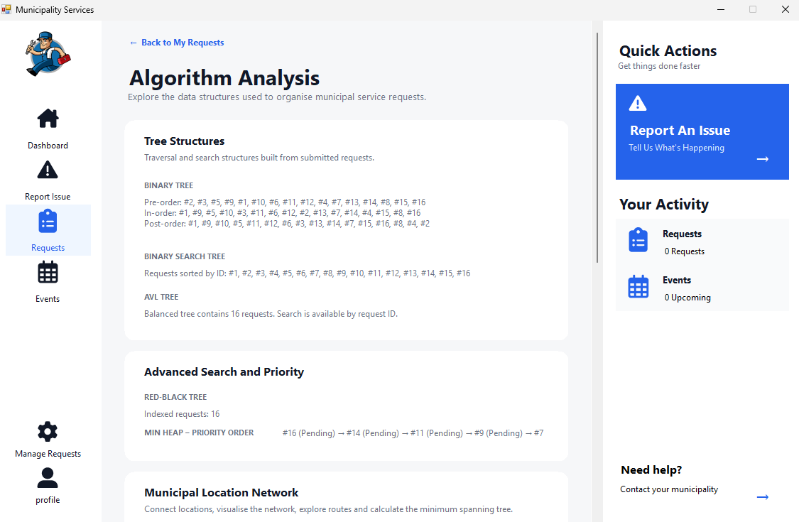

---

# 🧪 Testing and Verification

The following tests can be performed to verify the Part 3 functionality.

| Test                              | Expected Result                                                                  |
| --------------------------------- | -------------------------------------------------------------------------------- |
| Submit a new issue                | The issue is saved and receives a unique ID.                                     |
| Open Service Request Status       | Stored requests are displayed with their current statuses.                       |
| Select a request                  | The correct request details are displayed.                                       |
| Search through the BST            | The correct issue is returned when its ID exists.                                |
| Search through the AVL Tree       | The correct issue is returned while the tree maintains its balance.              |
| Search through the Red-Black Tree | The correct issue is returned while the tree maintains its balancing properties. |
| Traverse the Binary Tree          | Pre-order, in-order and post-order results are produced.                         |
| Insert requests into the heap     | Requests are organised according to the defined status and date ordering.        |
| Retrieve the next heap request    | The highest-priority request is returned.                                        |
| Add a graph connection            | The connection is stored between the selected locations.                         |
| Run BFS                           | Reachable locations are explored breadth first.                                  |
| Run DFS                           | Reachable locations are explored depth first.                                    |
| Run Kruskal's algorithm           | Minimum-weight connections are returned without cycles.                          |
| Update a request status           | The new status is saved and the relevant structures are refreshed.               |

## Example Graph Test Data

The following connections can be entered through the Algorithm Analysis page:

| Source       | Destination | Weight |
| ------------ | ----------- | -----: |
| Botlokwa CBD | Ga-Molepo   |     10 |
| Botlokwa CBD | Nobody      |      5 |
| Ga-Molepo    | Nobody      |      3 |
| Botlokwa CBD | Seshego     |     15 |
| Ga-Molepo    | Seshego     |      8 |
| Nobody       | Seshego     |      6 |

Expected MST result:

```text
Ga-Molepo - Nobody: 3
Botlokwa CBD - Nobody: 5
Nobody - Seshego: 6

Total Weight: 14
```

This provides a known result against which the MST implementation can be tested.

### 📸 Screenshot


---

# 🗄️ Data Storage

The application uses **SQL Server LocalDB** together with **Entity Framework 6**.

The database is named:

```text
MunicipalityServiceApp2Db
```

The main database tables include:

```text
Issues
Events
Announcements
__MigrationHistory
```

The `Issues` table stores submitted municipal service requests.

Each issue includes:

- Unique ID
- Location
- Category
- Description
- Optional attachment path
- Status
- Date reported

The basic data flow is:

```text
User
  |
  v
Windows Forms UI
  |
  v
Service Layer
  |
  v
Entity Framework 6
  |
  v
SQL Server LocalDB
```

The advanced data structures are populated from the issue information retrieved from the database.

The database remains the permanent source of stored request information.

---

# 🌱 Sample Data

The application can be tested using multiple service requests stored in the local database.

Sample requests can be inserted through SQL Server Object Explorer using a SQL query.

Example:

```sql
INSERT INTO dbo.Issues
(
    Location,
    Category,
    Description,
    AttachmentPath,
    Status,
    DateReported
)
VALUES
(
    'Botlokwa CBD',
    'Water',
    'Water pipe leaking near the main road.',
    NULL,
    'Pending',
    GETDATE()
);
```

Multiple records can be inserted using a single `INSERT INTO ... VALUES` statement.

The sample records allow the application to demonstrate:

- Request listing.
- Unique request identification.
- Tree insertion and searching.
- Heap priority ordering.
- Tree traversal.
- Request status updates.

The graph connections are entered separately through the Algorithm Analysis page.

---

# 🛠️ Technical Overview

## Technology

- **Language:** C#
- **Framework:** .NET Framework 4.8
- **UI:** Windows Forms
- **IDE:** Visual Studio 2022
- **Database:** SQL Server LocalDB
- **ORM:** Entity Framework 6
- **UI Icons:** FontAwesome.Sharp
- **Source Control:** GitHub

## NuGet Packages

- `EntityFramework 6.5.2`
- `FontAwesome.Sharp 6.6.0`

---

# 📂 Project Structure

The project is organised into separate folders to keep the application maintainable.

```text
MunicipalityServiceApp2
│
├── Data
│   └── MunicipalityDbContext.cs
│
├── Models
│   ├── Issue.cs
│   ├── Event.cs
│   ├── Announcement.cs
│   └── GraphEdge.cs
│
├── Services
│   ├── IssueService.cs
│   ├── IssueAlgorithmService.cs
│   ├── EventService.cs
│   ├── EventSeedService.cs
│   └── RecommendationService.cs
│
├── Helpers
│
├── DataStructures
│   ├── BinaryTree.cs
│   ├── BinarySearchTree.cs
│   ├── AVLTree.cs
│   ├── RedBlackTree.cs
│   ├── MinHeap.cs
│   ├── Graph.cs
│   ├── GraphTraversal.cs
│   └── MinimumSpanningTree.cs
│
├── Screenshots
│
├── MainForm.cs
├── MainForm.Designer.cs
├── Program.cs
├── App.config
└── packages.config
```

---

# 🎨 User Interface

The application uses a modern Windows Forms design focused on:

- 🤍 White cards
- ◻️ Light grey backgrounds
- 🔵 Blue primary actions
- Clean spacing
- Rounded cards
- FontAwesome icons
- Clear visual hierarchy
- Compact sidebar navigation
- Scrollable content areas
- Simple search and filtering controls

The Service Request Status and Algorithm Analysis sections are designed to display information clearly within the application's content area.

The Algorithm Analysis page uses scrollable content to accommodate the different data structure demonstrations and graph controls.

---

# 📸 Screenshots

The following screenshots demonstrate the completed application.

## 🏠 Main Dashboard


## 🚨 Report Issue


## 📋 Service Request Status


## 🔍 Request Details


## ⚙️ Manage Requests


## 🌳 Algorithm Analysis


## 🌲 Binary Tree and BST


## ⚖️ AVL Tree


## 🔴 Red-Black Tree


## ⬇️ Min-Heap


## 🌐 Graph Connections


## 🔎 Breadth-First Search


## 🔍 Depth-First Search


## 🌳 Minimum Spanning Tree


## 📅 Events and Announcements


## 🔎 Event Search and Filtering


## ⭐ Event Recommendations


## 📰 Announcements


---

# ⚠️ Current Limitations

The application focuses on the functionality required for the Municipal Services Application project.

Current limitations include:

- Authentication and user accounts are not implemented.
- The application uses SQL Server LocalDB and requires the appropriate local database environment.
- The graph uses manually entered connections and weights rather than automatically calculated geographical distances.
- The Min-Heap uses request status, reporting date and ID rather than a separate numeric priority property.
- The recommendation system uses a lightweight weighted scoring approach.
- The tree structures are rebuilt in memory when the issue structures are refreshed.
- The application is designed as a desktop application and does not currently include a mobile version.

---

# 🔮 Future Improvements

Potential future improvements include:

- 🔐 User authentication and role-based access.
- 👤 Resident profiles and account management.
- 🏛️ Municipal administrator dashboard.
- 🗺️ Integration with real geographical maps.
- 📍 Automatic calculation of route distances.
- 📊 Advanced municipal reporting and analytics.
- 🔔 Notifications for request status changes.
- 📱 Mobile application support.
- ☁️ Cloud database deployment.
- 🧪 Automated unit testing for data structures and algorithms.
- 📈 Improved performance for larger municipal datasets.

---

# 📂 Source Code

The complete source code for the application is available on GitHub:

**Repository:** [https://github.com/CodeByRelo/MunicipalityServiceApp2.git](https://github.com/CodeByRelo/MunicipalityServiceApp2.git)

---

# 👨‍💻 Project Information

**Application:** Municipal Services Application

**Part:** Part 3

**Version:** 3.0

**Developer:** Tshwarelo Lephoto - ST10535591

**Framework:** .NET Framework 4.8

**Language:** C#

---

# 📌 Part 3 Summary

Part 3 completes the Municipal Services Application by introducing the Service Request Status functionality and integrating advanced data structures and algorithms.

The completed application allows users to:

**Open the application → Report municipal issues → Browse local events → Search and filter announcements → View service requests → Track request progress.**

The application demonstrates practical implementation of:

**Binary Trees → Binary Search Trees → AVL Trees → Red-Black Trees → Min-Heaps → Graphs → BFS → DFS → Minimum Spanning Trees**

These structures and algorithms provide different ways of organising, retrieving and processing service request information and municipal location relationships.

The final application combines database persistence, Windows Forms functionality and advanced algorithmic techniques to provide a complete Municipal Services Application.

---

**End of Part 3 Implementation Documentation**
