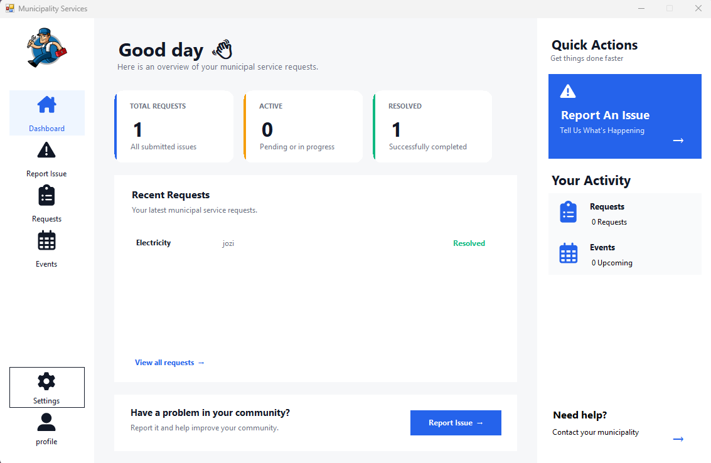
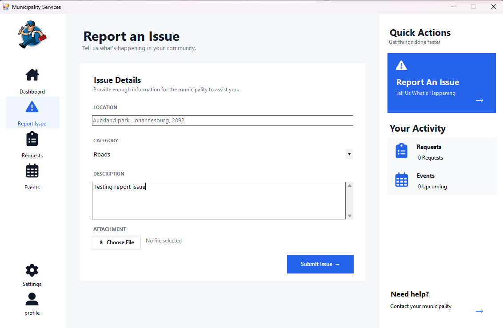
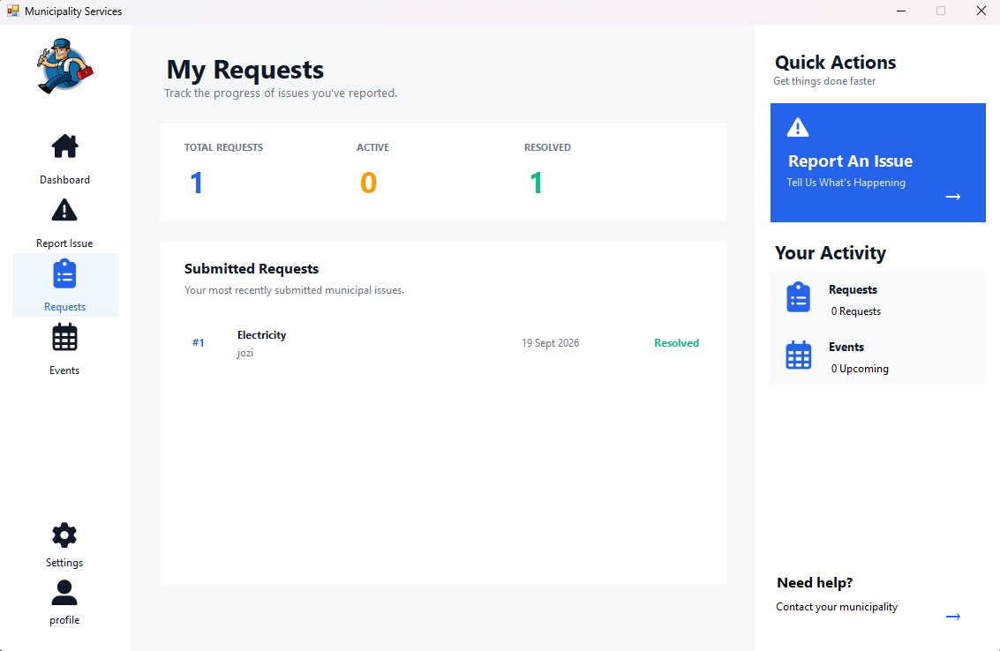
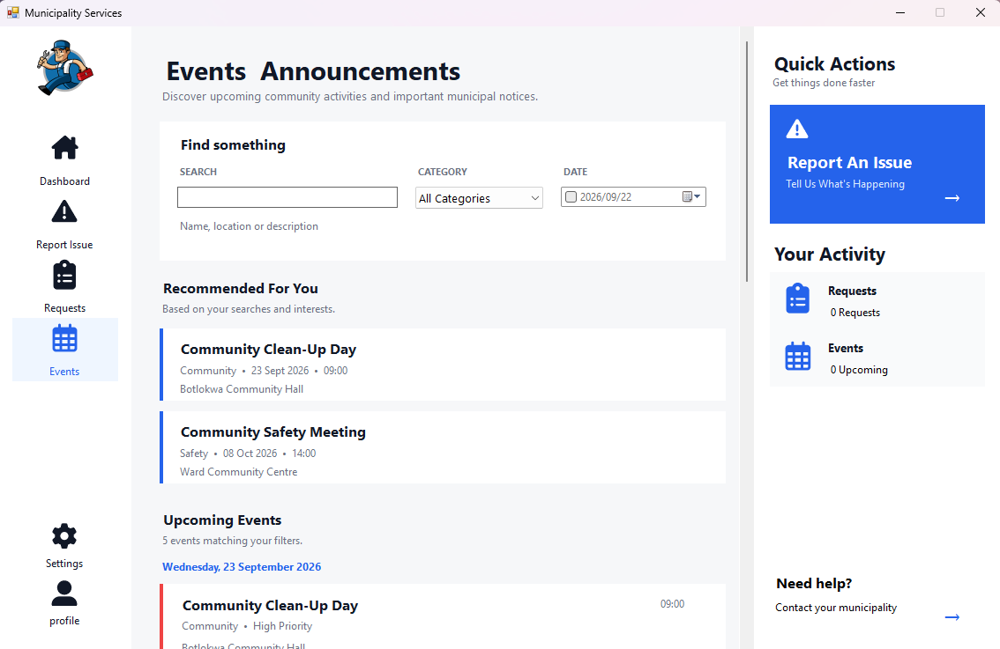
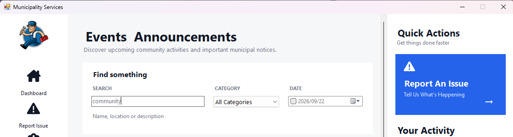
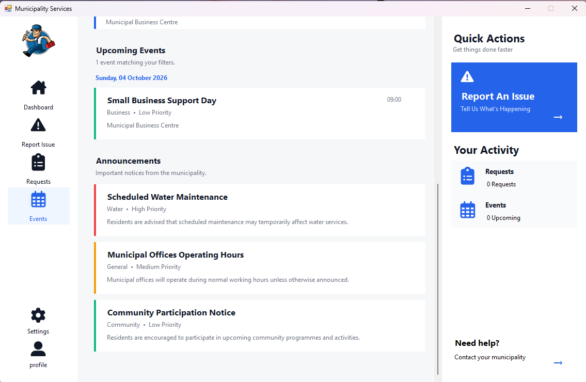

# 🏙️ Municipal Services Application - ST10535591

A Windows Forms desktop application designed to provide community members with access to municipal services, local events, announcements, and service request information.

The application was developed as **Part 2** of the Municipal Services Application project, building on the Part 1 issue-reporting functionality. Part 2 focuses on **Local Events and Announcements**, advanced data structures, event searching and filtering, and a recommendation feature based on user search patterns.

---

## 🚀 Getting Started

### Requirements

Before running the application, make sure you have:

* 🪟 Windows 10 or Windows 11
* 💻 Visual Studio 2022 or later
* 🧩 .NET Desktop Development workload
* 🛠️ .NET Framework 4.8 Developer Pack
* 🗄️ SQL Server LocalDB
* 📦 NuGet package support

The application uses **SQL Server LocalDB** for data storage.

---

## 📥 Download / Clone the Project

Clone the GitHub repository:

```
git clone [INSERT YOUR PART 2 GITHUB URL]
```

Or download the repository as a ZIP file from GitHub and extract it.

---

## ▶️ Compile and Run

1. Open `MunicipalityServiceApp2.sln` in Visual Studio.
2. Allow Visual Studio to restore the required NuGet packages.
3. Confirm that SQL Server LocalDB is installed and available.
4. Select **Build → Build Solution**.
5. Confirm that the solution builds successfully.
6. Press **F5** or select **Debug → Start Debugging**.
7. The Municipal Services application will open on the main dashboard.

The application uses Entity Framework 6 to communicate with the SQL Server LocalDB database.

---

# 🧭 Using the Application

## 🏠 Main Dashboard

The dashboard is the main entry point of the application.

It provides:

* Welcome section
* Municipal service statistics
* Report Issue action
* Recent requests
* Quick access options
* Sidebar navigation

The main navigation provides access to:

* 🚨 Report Issue
* 📋 My Requests
* 📅 Events
* ⚙️ Manage Requests

### 📸 Screenshot



---

## 🚨 Reporting an Issue

The Part 1 issue-reporting functionality has been carried forward into Part 2.

To submit a municipal issue:

1. Select **Report Issue**.
2. Enter the issue location.
3. Select a category.
4. Enter a description.
5. Optionally select supporting evidence.
6. Select **Submit Issue**.

### Available Categories

* 🧹 Sanitation
* 🛣️ Roads
* 💧 Water
* ⚡ Electricity
* 🗑️ Waste Management
* 📌 Other

Submitted issues are stored in the SQL Server database and assigned an initial **Pending** status.

### 📸 Screenshot



---

## 📋 Service Request Status

Users can view previously submitted municipal issues through **My Requests**.

Each request provides information such as:

* Request ID
* Category
* Status
* Date reported
* Location
* Description
* Attachment information

Requests can be selected to view their current progress.

The request status uses the following stages:

**Pending → In Progress → Resolved**

### 📸 Screenshot



---

# 📅 Local Events and Announcements

The Local Events and Announcements page provides users with upcoming community events and active municipal announcements.

Events are retrieved from the SQL Server database and displayed using a card-based interface.

Each event can display:

* Event name
* Category
* Priority
* Date
* Time
* Location

Users can select an event to view additional information.

### 📸 Screenshot



---

# 🔎 Event Search and Filtering

The Events page provides several ways to find relevant events.

Users can search using:

* Event name
* Location
* Description

Events can also be filtered by:

* Category
* Date

The search results update dynamically based on the selected filters.

### 📸 Screenshot



---

# ⭐ Event Recommendations

The application includes a recommendation feature based on user searches and preferences.

The system records:

* Search keywords
* Selected event categories
* Repeated searches

These preferences are used to calculate recommendation scores for upcoming events.

Events receive higher scores when they are related to the user's previous searches or selected categories.

The recommendation system considers factors such as:

* Category matches
* Keyword matches in event titles
* Keyword matches in descriptions
* Keyword matches in locations
* Event priority

The highest-scoring events are presented in the **Recommended For You** section.

### 📸 Screenshot


---

# 📰 Announcements

Active municipal announcements are displayed below the upcoming events.

Announcements provide information such as:

* Announcement title
* Category
* Priority
* Message

Only active announcements are displayed to users.

### 📸 Screenshot



---

# 🧠 Advanced Data Structures

Part 2 makes use of several data structures to organise and process event-related information.

## Stack

A `Stack<Event>` is used to maintain a history of recently viewed events.

When a user opens an event, the event is pushed onto the stack.

The stack follows the **Last In, First Out (LIFO)** principle.

```text
User opens event
       ↓
viewedEvents.Push(event)
       ↓
Recently viewed event history
```

---

## Queue

A `Queue<Event>` is used to process upcoming events in chronological order.

Events are added to the queue according to their upcoming event date.

The queue follows the **First In, First Out (FIFO)** principle.

```text
Upcoming Events
       ↓
Queue<Event>
       ↓
Process events in order
```

---

## Priority Queue

Events are organised according to their priority and event date.

Priority levels include:

* 🔴 High
* 🟠 Medium
* 🟢 Low

High-priority events are processed before lower-priority events.

---

## Dictionary

A `Dictionary<string, List<Event>>` is used to group events by category.

For example:

```
Community → Events
Youth → Events
Business → Events
Safety → Events
```

This allows events to be organised and retrieved efficiently by category.

---

## Sorted Dictionary

A `SortedDictionary<DateTime, List<Event>>` is used to group events by date.

This keeps event dates organised chronologically when events are displayed.

```text
Date
 ↓
Events on that date
 ↓
Next date
 ↓
Events on that date
```

---

## HashSet

`HashSet<string>` is used to maintain unique event categories.

A `HashSet<DateTime>` is also used to maintain unique event dates.

Sets prevent duplicate values from being stored unnecessarily.

---

# 🤖 Recommendation Algorithm

The recommendation feature uses a weighted scoring approach.

An event can receive points based on its relationship to the user's search behaviour.

Example scoring:

```
Category match          +3
Title keyword match     +2
Description match       +2
Location match          +1
High priority           +1
```

Repeated searches increase the corresponding preference count.

The events are then ordered according to their calculated recommendation score, and the highest-scoring events are presented to the user.

This provides a simple and explainable recommendation algorithm suitable for the application.

---

# 🗄️ Data Storage

Part 2 uses **SQL Server LocalDB** together with **Entity Framework 6**.

The database is named:

```
MunicipalityServiceApp2Db
```

The main database tables include:

```
Issues
Events
Announcements
__MigrationHistory
```

The basic data flow is:

**User → Windows Forms UI → Service Layer → Entity Framework → SQL Server LocalDB**

---

# 🌱 Sample Event and Announcement Data

The application includes a seed service used during development to populate the database with sample events and announcements.

Example events include:

* 🧹 Community Clean-Up Day
* 👥 Youth Development Workshop
* 💧 Water Conservation Awareness
* 💼 Small Business Support Day
* 🛡️ Community Safety Meeting

Example announcements include:

* 💧 Scheduled Water Maintenance
* 🏢 Municipal Offices Operating Hours
* 📢 Community Participation Notice

This provides realistic data for demonstrating the Events, Announcements, search, filtering, and recommendation functionality.

---

# 🛠️ Technical Overview

### Technology

* **Language:** C#
* **Framework:** .NET Framework 4.8
* **UI:** Windows Forms
* **IDE:** Visual Studio 2022
* **Database:** SQL Server LocalDB
* **ORM:** Entity Framework 6
* **UI Icons:** FontAwesome.Sharp
* **Source Control:** GitHub

### NuGet Packages

* `EntityFramework 6.5.2`
* `FontAwesome.Sharp 6.6.0`

---

# 📂 Project Structure

```
MunicipalityServiceApp2
│
├── Data
│   └── MunicipalityDbContext.cs
│
├── Models
│   ├── Issue.cs
│   ├── Event.cs
│   └── Announcement.cs
│
├── Services
│   ├── IssueService.cs
│   ├── EventService.cs
│   ├── EventSeedService.cs
│   └── RecommendationService.cs
│
├── Helpers
│
├── MainForm.cs
├── MainForm.Designer.cs
├── Program.cs
├── App.config
└── packages.config
```

---

# 🎨 User Interface

The application uses a modern Windows Forms design focused on:

* 🤍 White cards
* ◻️ Light grey backgrounds
* 🔵 Blue primary actions
* Clean spacing
* Rounded cards
* FontAwesome icons
* Clear visual hierarchy
* Compact sidebar navigation
* Scrollable content areas
* Simple search and filtering controls

The Events and Announcements page was designed to remain usable within the application's fixed content area while allowing the user to scroll through larger amounts of information.

---

# 📸 Screenshots

Screenshots of the completed Part 2 application are available below.

### 🏠 Main Dashboard


### 📅 Events and Announcements


### 🔎 Event Search and Filtering


### ⭐ Recommended Events


### 📰 Announcements


### 📋 Request Status


### 🚨 Report Issue


---

# ⚠️ Current Limitations

The application is focused on the functionality required for Part 2.

Current limitations include:

* Event and announcement creation is currently handled through seeded database data rather than a public administration interface.
* Authentication and user accounts are not implemented.
* Recommendations are based on searches made during the current application session.
* The application uses SQL Server LocalDB and therefore requires the appropriate local database environment.
* The recommendation system uses a lightweight weighted scoring algorithm rather than a machine-learning model.

---

# 🔮 Future Improvements

Potential future improvements include:

* 🔐 User authentication
* 👤 User profiles and persistent preferences
* 🏛️ Municipal administrator interface
* 📅 Event management
* 📰 Announcement management
* 💾 Persistent recommendation preferences
* 📊 Analytics and reporting
* 🔔 Notifications for upcoming events
* 📱 Mobile support
* ☁️ Cloud database deployment

---

# 📂 Source Code

The complete source code for the application is available on GitHub:

**Repository:** [INSERT YOUR PART 2 GITHUB URL]

---

# 👨‍💻 Project Information

**Application:** Municipal Services Application
**Part:** Part 2
**Version:** 2.0
**Developer:** Tshwarelo Lephoto - ST10535591

---

## 📌 Part 2 Summary

Part 2 expands the Municipal Services Application by introducing local events and announcements together with advanced data structures and algorithms.

The completed application allows a user to:

**Open the application → Browse events → Search and filter events → Receive recommendations → View announcements → View service request information.**

The application demonstrates practical use of:

**Stacks → Queues → Priority Processing → Dictionaries → Sorted Dictionaries → Sets → Recommendation Algorithms**

while maintaining a simple, organised, and user-friendly Windows Forms interface.
